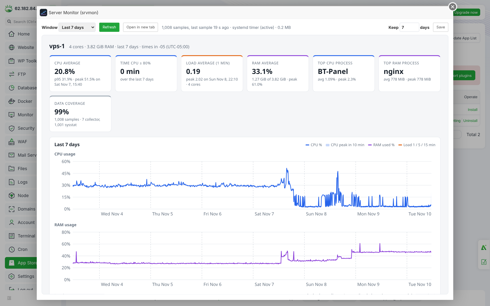
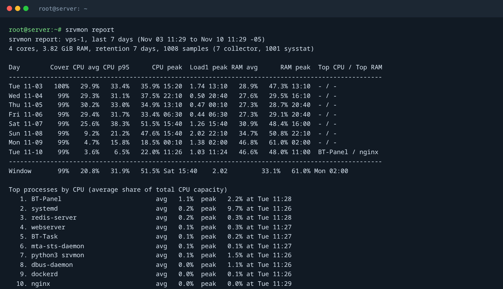
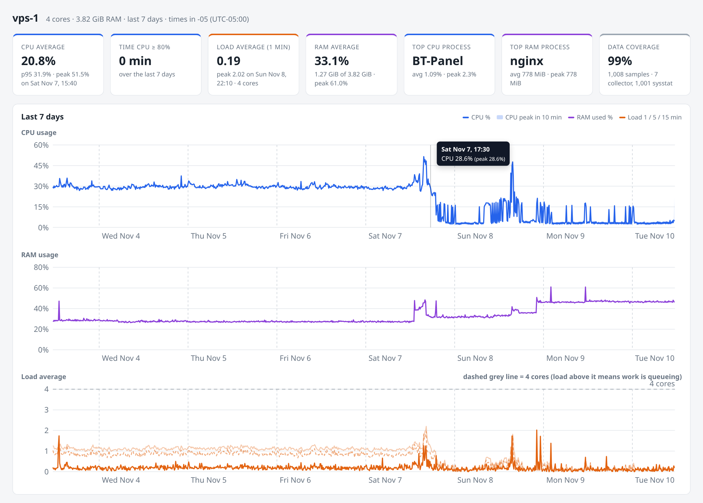
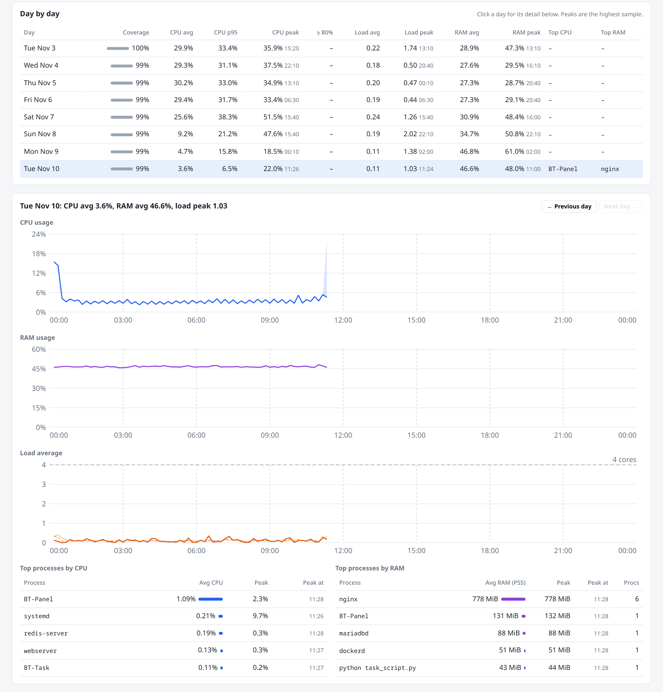
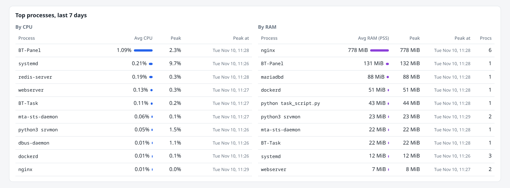
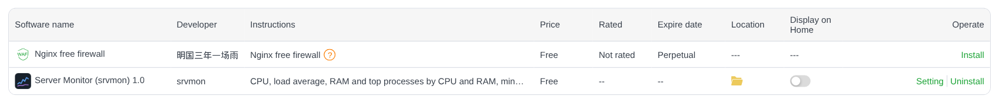

# srvmon

**See how your server's CPU, load, RAM and busiest processes behaved, minute by minute, over the last 7 days.**

srvmon is a single Python file (standard library only) that records one sample per minute into SQLite, deletes anything older than the retention window (7 days by default), and shows the result as a daily text report, a self-contained HTML dashboard, JSON, or a plugin inside [aaPanel](https://www.aapanel.com). It runs on any Linux server with Python 3.6+.



## Contents

- [What it records](#what-it-records)
- [Quick start](#quick-start)
- [Viewing the data](#viewing-the-data)
- [Configuration](#configuration)
- [aaPanel](#aapanel)
- [Reusing it on other servers](#reusing-it-on-other-servers)
- [How it works](#how-it-works)
- [Upgrade and uninstall](#upgrade-and-uninstall)
- [Troubleshooting](#troubleshooting)
- [Development](#development)

## What it records

Every minute, one row per sample:

| Metric | Details |
|--------|---------|
| CPU usage | Share of all cores that was busy since the previous sample (an average over the minute, not a snapshot). Also stores user, nice, system, iowait and steal. |
| Load average | 1, 5 and 15 minute load, shown against the number of cores. |
| RAM | Used memory as `MemTotal - MemAvailable`, which leaves out cache the kernel can free on demand. Percent and bytes, plus swap. |
| Top processes by CPU | The 5 process groups that used the most CPU during that minute. |
| Top processes by RAM | The 5 process groups holding the most memory (PSS when the kernel provides it, otherwise RSS). |

Processes are grouped by name, so 8 `php-fpm` workers count as one `php-fpm` entry with their CPU and memory added up. Scripts run by an interpreter are named after the script (`python3 backup.py`, `node server.js`), and kernel threads like `kworker/u8:1` are folded into `kworker`.

From those samples srvmon computes, per day and for the whole window: average, 95th percentile and peak (with the time it happened), minutes spent above the alert threshold, hour-by-hour averages, and the top processes ranked by average CPU and by average memory.

## Quick start

On the server you want to monitor, as root:

```bash
git clone https://github.com/CristhianBuiza/srvmon.git
cd srvmon
sudo ./install.sh
```

That's it. The installer:

1. Copies srvmon to `/opt/srvmon` and links the `srvmon` command into `/usr/local/bin`.
2. Writes `/etc/srvmon.conf` with 7-day retention (kept as-is on re-runs).
3. Schedules `srvmon collect` every minute with a systemd timer (or cron when systemd is not available).
4. Takes the first sample, then backfills the last 7 days of CPU, load and RAM from sysstat if `sar` history exists on the machine.
5. Installs the aaPanel plugin if aaPanel is detected.

Check that it is collecting:

```bash
srvmon status     # last_native_age_s should stay under 60
srvmon report     # 7-day daily table
```

Useful installer options:

```bash
sudo ./install.sh --retention 14 --label web-01   # keep 14 days, name the server "web-01"
sudo ./install.sh --top 10                        # record the top 10 processes instead of 5
sudo ./install.sh --scheduler cron                # use cron even if systemd exists
sudo ./install.sh --no-plugin --no-sysstat-import
sudo ./install.sh --help
```

## Viewing the data

### Text report

```bash
srvmon report                    # one line per day for the retention window, plus top processes
srvmon report --days 3           # shorter window
srvmon report --day 2026-11-09   # hour by hour for one day, with that day's top processes
srvmon report --json             # everything as JSON, for scripts and other tools
```



### HTML dashboard

The dashboard is one HTML file with the data embedded. It has no external scripts, fonts or CDN calls, so it works offline and can be emailed or archived.

```bash
srvmon html --out /tmp/srvmon.html                 # write a snapshot, then download it (scp, SFTP, the panel file manager)
srvmon serve                                       # live dashboard on http://127.0.0.1:8765
ssh -L 8765:127.0.0.1:8765 root@your-server        # from your computer, then open http://localhost:8765
```

`srvmon serve` binds to localhost by default. To expose it on a network interface, always pass a token: `srvmon serve --bind 0.0.0.0 --token "$(openssl rand -hex 16)"` and open `http://server:8765/?token=...`. The JSON behind the page is at `/api/summary`.

**Last 7 days.** Summary cards, then CPU (the shaded band is the highest minute inside each 10-minute point), RAM, and load average against the core count. Hover any chart for exact values.



**Day by day.** One row per day. Click a day to see its CPU, RAM and load at 10-minute resolution and its top processes. The URL keeps the selected day (`#2026-11-09`), so you can share a link to one day.



**Top processes for the whole window**, by average CPU and by average memory, with the peak and when it happened.



All times are shown in the server's time zone, whatever time zone the viewer's browser uses.

### Export for an AI assistant

`srvmon export` writes the whole retention window as one Markdown file meant to be pasted into an AI chat (ChatGPT, Claude, Gemini and so on) or attached to it, so you can ask things like "why was CPU high on Saturday afternoon?" or "is this server short on RAM?".

```bash
srvmon export --out /root/                   # writes /root/srvmon-<label>-<YYYYMMDD-HHMM>.md
srvmon export > vps-1.md                     # or print to stdout and redirect
srvmon export --days 3 --detail 10min --out last3days.md
```

In aaPanel, the plugin's **Export for AI (.md)** button downloads the same file for the selected window. `srvmon serve` offers it at `/export.md` (also linked from the page header), with the same `days` and `detail` parameters.

The file explains its own units, so the AI does not have to guess them. In order, it contains:

1. **Server facts:** label, cores, RAM, number of samples, coverage, and when per-process data starts.
2. **How to read the numbers:** what CPU %, load and RAM used mean, and how processes are grouped.
3. **Summary table:** average, 95th percentile and peak (with time) for CPU, load and RAM, plus time spent above the alert thresholds.
4. **Day-by-day table** with each day's top CPU and top RAM process.
5. **Top processes** for the window by CPU and by RAM, then a one-line summary per day.
6. **Time series as CSV**: `time,cpu_avg,cpu_max,load1,load5,load15,ram_pct,ram_used_mib`, hourly by default or every 10 minutes with `--detail 10min`.

A full week is about 13 KB at hourly detail and about 55 KB at 10-minute detail, small enough for any current AI chat. An excerpt:

~~~markdown
## Summary

| Metric | Average | 95th percentile | Peak |
|---|---|---|---|
| CPU | 13.8% | 33.6% | 42.1% at 2026-11-09 12:31 |
| Load (1 min) | 0.55 | - | 1.68 at 2026-11-09 12:31 |
| RAM used | 42.8% (1.63 GiB) | 46.7% | 48.4% at 2026-11-09 12:31 |

## Time series (hourly)

```csv
time,cpu_avg,cpu_max,load1,load5,load15,ram_pct,ram_used_mib
2026-11-03 12:00,34.7,39.9,1.39,1.28,1.16,46.9,1833
```
~~~

The export holds process names and resource figures, but not command-line arguments, environment variables or file contents. Read it before sharing it if your process or server names are sensitive.

## Configuration

`/etc/srvmon.conf`, one `KEY=VALUE` per line. Changes apply from the next sample; nothing needs restarting.

| Key | Default | Meaning |
|-----|---------|---------|
| `RETENTION_DAYS` | `7` | Days of history to keep. Older rows are deleted every minute, and the freed space is returned to the disk. |
| `TOP_N` | `5` | Process groups stored per sample: the top N by CPU plus the top N by RAM. |
| `CPU_ALERT` | `80` | CPU % drawn as a red line and counted in "time above". |
| `RAM_ALERT` | `90` | RAM % drawn as a red line and counted in "time above". |
| `LABEL` | hostname | Name shown in reports and on the dashboard. |
| `DB_PATH` | `/var/lib/srvmon/srvmon.db` | SQLite database. |
| `SYSSTAT_DIRS` | `/var/log/sysstat:/var/log/sa` | Where `srvmon import-sysstat` looks for `sar` files (Debian/Ubuntu, then RHEL layout). |

Every key can also be set for a single command with an environment variable, for example `SRVMON_RETENTION_DAYS=3 srvmon report`. Use `SRVMON_CONFIG=/path/file` to point at another config file.

**Changing the retention window.** Edit `RETENTION_DAYS` and run `srvmon prune` to apply it right away, or use the "Keep N days" box in the aaPanel plugin. Shortening the window deletes data immediately. Lengthening it only keeps future data longer; deleted rows do not come back.

**Disk use.** A full week at the defaults is about 10,000 samples and 100,000 process rows, roughly 7 MB.

## aaPanel

The plugin is a thin page on top of the same collector. It appears under **App Store → Third-party Plug-ins → Server Monitor (srvmon) → Setting**.



Inside the plugin you can pick the window (24 hours, 3 or 7 days), refresh, open the dashboard full screen in a new tab, download the [AI export](#export-for-an-ai-assistant), and change the retention. The status line shows how many samples exist, how old the last one is, and whether the timer is active.

There are two ways to install it:

- **From the repository (recommended).** Run `sudo ./install.sh`. When `/www/server/panel` exists, the plugin is installed automatically. Add `--panel-monitor` to also switch on aaPanel's own Monitor page (Monitor menu) with the same retention, so both keep the same number of days.
- **From the panel, without SSH.** Download `srvmon-aapanel-plugin.zip` from the [latest release](https://github.com/CristhianBuiza/srvmon/releases/latest), then go to **App Store → Third-party Plug-ins → Import plugins** and upload it. The zip includes the collector and runs the same installer.

Uninstalling the plugin from the App Store only removes the panel page. The collector and its data stay; see [Upgrade and uninstall](#upgrade-and-uninstall) to remove those.

aaPanel shows a warning for every third-party plugin. srvmon's plugin only reads the srvmon database and writes `RETENTION_DAYS` to `/etc/srvmon.conf`. Its source is [`aapanel-plugin/srvmon/srvmon_main.py`](aapanel-plugin/srvmon/srvmon_main.py), about 110 lines.

## Reusing it on other servers

Nothing in srvmon is tied to one machine. For each server:

```bash
git clone https://github.com/CristhianBuiza/srvmon.git && cd srvmon
sudo ./install.sh --label "$(hostname -s)"      # or any name, e.g. --label db-prod
```

| Server type | What happens |
|-------------|--------------|
| Ubuntu / Debian / RHEL / Rocky / Alma, systemd | systemd timer `srvmon-collect.timer`. |
| No systemd (SysV init, some containers) | `/etc/cron.d/srvmon` (needs a cron daemon that reads `/etc/cron.d`), or force it with `--scheduler cron`. |
| aaPanel installed | Plugin added automatically (`--no-plugin` to skip). |
| sysstat installed with history | Last `RETENTION_DAYS` of CPU, load and RAM backfilled on install. |
| No sysstat | History starts at install time. |
| Old kernel (< 4.14) | Process memory falls back from PSS to RSS; the dashboard labels which one is used. |

To compare servers, give each one a `--label`. To collect reports centrally, run `srvmon report --json` (or fetch `/api/summary` from `srvmon serve --token ...`) from your own tooling.

## How it works

```
systemd timer / cron (every minute)
        │
        ▼
srvmon collect ──► reads /proc/stat, /proc/loadavg, /proc/meminfo, /proc/<pid>/stat, /proc/<pid>/smaps_rollup
        │
        ▼
/var/lib/srvmon/srvmon.db  (samples, proc_samples, meta)  ── rows older than RETENTION_DAYS deleted on every run
        │
        ├──► srvmon report [--day | --json]     text or JSON
        ├──► srvmon export                      Markdown for pasting into an AI chat
        ├──► srvmon html / serve                self-contained dashboard (srvmon/dashboard.html template)
        └──► aaPanel plugin                     same dashboard inside the panel
```

- **CPU is measured over the whole minute.** Each run stores the kernel's CPU counters and compares them with the previous run, so a 20-second burst between samples is still counted. Per-process CPU works the same way, using each process's CPU time.
- **Process CPU % is a share of the whole machine**, the same scale as the system CPU. On a 4-core server, one process pegging one core shows as 25%.
- **Process memory prefers PSS**, which splits shared pages between the processes that use them. RSS, which counts shared memory once per process, overstates groups like php-fpm or postgres workers.
- **Averages are time-weighted.** A 10-minute sysstat sample weighs ten times a 1-minute sample, and gaps longer than 15 minutes (server down, collector stopped) are left as gaps instead of stretched across.
- **sysstat backfill** fills only the time before srvmon's first own sample, so the two sources never overlap. sysstat has no per-process data, so the process tables start at install time.
- **Cost.** One run takes about 0.3 s of CPU on a server with ~190 processes (about 0.5% of one core, once a minute). It runs at nice 10 with idle I/O priority.

## Upgrade and uninstall

```bash
cd srvmon && git pull && sudo ./install.sh      # upgrade; config and data are kept
sudo /opt/srvmon/uninstall.sh                   # remove srvmon, keep /etc/srvmon.conf and the database
sudo /opt/srvmon/uninstall.sh --purge           # remove everything, including collected data
```

## Troubleshooting

| Symptom | Check |
|---------|-------|
| `last_native_age_s` keeps growing | `systemctl status srvmon-collect.timer` and `journalctl -u srvmon-collect.service -n 20`. With cron: `grep srvmon /var/log/syslog`. |
| Process tables say "no process data yet" | Normal for days before installation; sysstat backfill has no process data. |
| Coverage below 100% | Minutes without a sample: the server was off, the collector was stopped, or (backfilled days) sysstat only samples every 10 minutes, which still counts as covered. |
| Plugin says "srvmon core not found" | The plugin files are present but the collector is not. Run `sudo ./install.sh` from the repository. |
| Plugin not listed in aaPanel | Check that `/www/server/panel/plugin/srvmon/info.json` exists, then click **Update App List** in the App Store. |
| `sysstat: 0 samples imported` | sysstat is not collecting (`/etc/default/sysstat`, `systemctl status sysstat`), or its files are older than the retention window. |
| Peaks look lower on older days | Backfilled sysstat points are 10-minute averages; srvmon's own samples are 1-minute averages, so short spikes show up higher. |

## Development

```bash
python3 -m unittest discover -s tests -v      # tests use temporary databases, no root needed
./tools/build-plugin-zip.sh                    # builds dist/srvmon-aapanel-plugin.zip
```

Regenerating the README images from any server's data:

```bash
srvmon html --out dashboard.html && srvmon report > report.txt
npm i playwright-core && npx playwright install chromium
node tools/screenshots.js dashboard.html report.txt docs/images
```

The images in this README come from a real 4-core aaPanel server (labelled `vps-1`). The first days are backfilled from sysstat; process data starts on the install day.

| Path | Contents |
|------|----------|
| `srvmon/srvmon.py` | Collector, storage, aggregation, CLI, HTTP server. |
| `srvmon/dashboard.html` | Dashboard template (vanilla JS + inline SVG). |
| `aapanel-plugin/srvmon/` | aaPanel plugin: `info.json`, backend, page, icon, zip-import hook. |
| `install.sh`, `uninstall.sh` | Installer and uninstaller. |
| `tests/` | Unit tests. |
| `tools/` | Plugin zip builder and screenshot script. |

## License

MIT. See [LICENSE](LICENSE).
